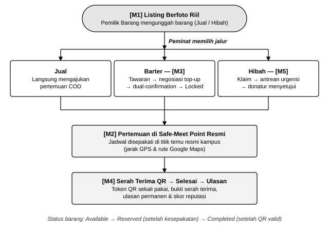
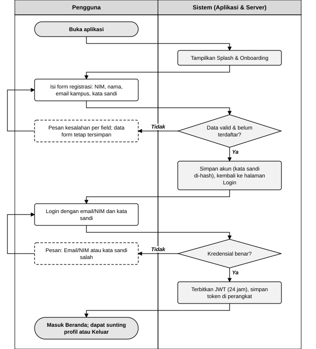
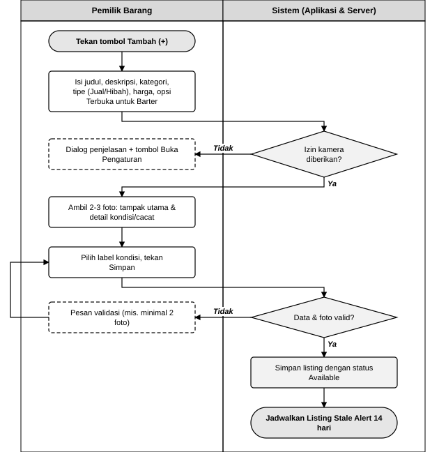
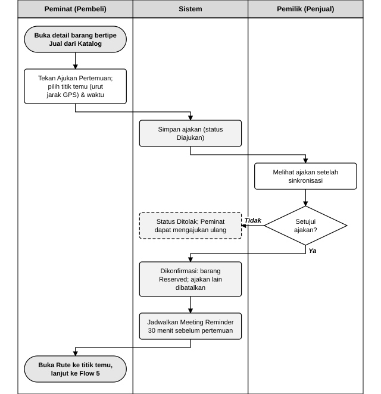
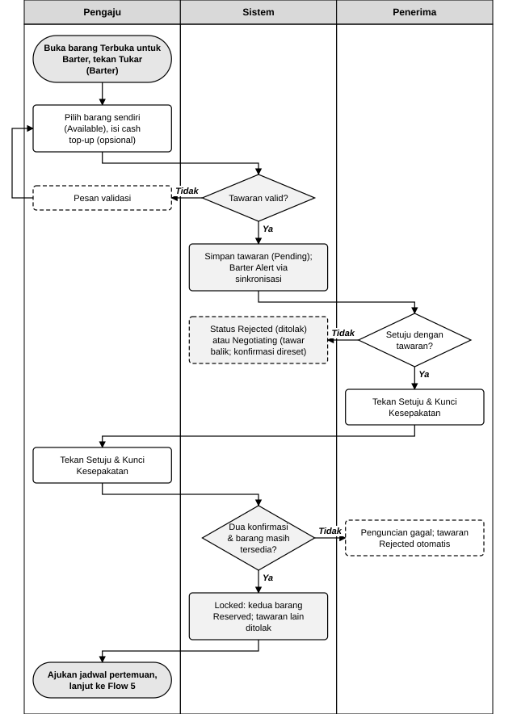
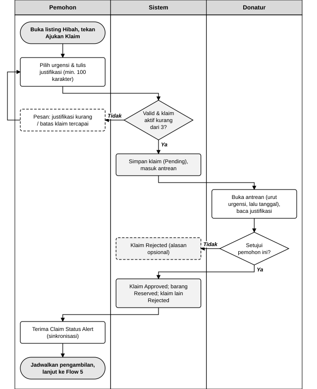
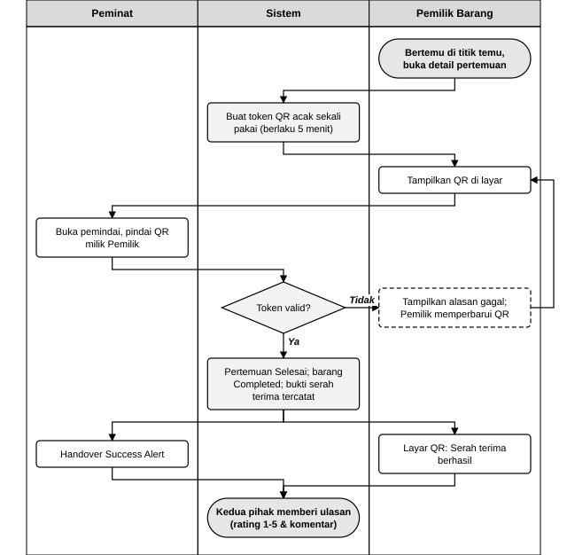

# PROJECT PRD
## Product Requirements Document

- **Project Name**: CampuShift - Aplikasi Mobile Pengalihan Barang Bekas Antar Mahasiswa yang Aman dan Tepercaya
- **Team**: 
  - Muhammad Racha Ardiwinata (2411522020)
  - Bayu Mutawakkil (2411522023)
  - Muhammad Habib (2411522024)
  - Naufal Baihaqi Zachwan (2411522025)
  - Fadel Muhammad (2411522029)
- **Course**: Mobile Programming
- **Version**: 1.3
- **Date**: 18 Oktober 2026

### Tujuan Dokumen
PRD ini digunakan untuk menjelaskan apa yang akan dibangun, untuk siapa, mengapa produk dibutuhkan, dan kebutuhan utama produk. PRD tidak perlu menjelaskan detail implementasi kode. Dokumen ini menjadi acuan spesifikasi fungsional dan teknis bagi tim pengembang dalam membangun aplikasi mobile CampuShift.

### Cara Membaca Dokumen
- **FR-xx** adalah functional requirement, **NFR-xx** non-functional requirement, **BR-xx** aturan bisnis/validasi, **AC-xx** kriteria penerimaan (cara menguji bahwa requirement terpenuhi), **N-xx** notifikasi, dan **UAT-xx** skenario uji akhir.
- Label **[W] Wajib** menandai requirement yang menjadi target demo dan penilaian; **[O] Opsional** dikerjakan bila waktu tersisa.
- Seluruh angka batas (durasi, panjang teks, jumlah maksimal) dikumpulkan di bagian **2.12 Parameter Sistem** agar mudah disesuaikan tanpa mengubah requirement.
- Istilah **Hapus** (Delete permanen) dan **Batalkan** (perubahan status) dibedakan secara tegas; lihat glosarium.
- Ringkasan operasi CRUD setiap modul ada di bagian **2.11**.

### Riwayat Revisi

| Versi | Tanggal | Ringkasan |
|---|---|---|
| 1.0 | 13 September 2026 | PRD awal. |
| 1.1 | 11 Oktober 2026 | Revisi sesuai umpan balik dosen: scope dipersempit ke satu masalah utama, peran pengguna didefinisikan, mekanisme notifikasi disesuaikan dengan batasan teknis, dan fitur disederhanakan serta diberi prioritas. |
| 1.2 | 13 Oktober 2026 | Perincian tanpa menambah fitur: glosarium, skenario pengguna, daftar layar, aturan bisnis & validasi, kriteria penerimaan per modul, siklus status entitas, katalog notifikasi, penanganan izin & error, ketergantungan antar modul, parameter sistem, matriks keterlacakan, dan skenario uji. |
| 1.3 | 18 Oktober 2026 | Pesan teks pada tawaran barter ditiadakan (komunikasi lanjutan direncanakan lewat WhatsApp). Kampus pilot ditetapkan Universitas Andalas (Unand) dan peran peta diperjelas sebagai tampilan visual titik temu COD di sekitar Unand. Diagram alur inti dan diagram swimlane setiap user flow ditambahkan. Ulasan dibuat permanen (tidak dapat dihapus, sunting 1 kali dalam 7 hari). Setiap modul memiliki operasi Delete permanen yang dibedakan dari pembatalan, dengan ringkasan CRUD per modul. Penomoran BR/AC dirapikan, functional requirement CRUD diuraikan per operasi, dan asumsi konektivitas serta data lokal ditambahkan. |

### Istilah Penting (Glosarium)

| Istilah | Arti dalam CampuShift |
|---|---|
| Listing | Data barang yang diunggah Pemilik Barang, bertipe **Jual** (berharga) atau **Hibah** (gratis). |
| Jalur Transaksi | Cara barang berpindah tangan: **Jual** (COD tunai), **Barter** (tukar barang, bisa dengan selisih tunai), atau **Hibah** (gratis melalui klaim). |
| Pemilik Barang / Peminat | Peran pengguna dalam satu transaksi (lihat 1.3). |
| Cash Top-Up | Selisih uang tunai yang disepakati dalam barter karena nilai kedua barang tidak sama. |
| Dual-Confirmation | Kedua pihak barter wajib menekan "Setuju & Kunci Kesepakatan" dari akun masing-masing. |
| Locked | Status tawaran barter setelah kedua pihak mengonfirmasi; kedua barang ikut menjadi Reserved. |
| Reserved | Status barang yang sedang dalam kesepakatan sehingga tidak dapat diajukan pengguna lain. |
| Safe-Meet Point | Titik temu COD resmi di lingkungan dan sekitar kampus Universitas Andalas (pos satpam, perpustakaan, dan sejenisnya) yang ditetapkan tim. |
| Peta Titik Temu | Peta (flutter_map dengan tile OpenStreetMap) yang hanya menampilkan lokasi Safe-Meet Point dan posisi pengguna secara visual; tidak dipakai untuk menampilkan barang atau rute. |
| Meetup (Pertemuan) | Jadwal pertemuan serah terima; juga menjadi acuan "transaksi" untuk validasi QR dan ulasan. |
| Token QR | Kode acak sekali pakai dari server, berlaku singkat, yang ditampilkan sebagai kode QR saat serah terima. |
| Sinkronisasi | Pemeriksaan data terbaru ke server saat aplikasi dibuka, aktif kembali, di-refresh, atau berkala selama aktif. |
| Hapus vs Batalkan | **Hapus** (Delete) menghilangkan data dari basis data secara permanen dan hanya berlaku untuk data yang belum ditanggapi pihak lain. **Batalkan** mengubah status menjadi Dibatalkan/Cancelled agar riwayat tetap tersimpan, dan dipakai setelah pihak lain terlibat. |

## 1. Problem & Users

### 1.1 Problem Statement
Mahasiswa yang ingin melepas atau memperoleh barang bekas perlengkapan kuliah di lingkungan kampus saat ini bergantung pada grup chat dan media sosial. Pada saluran tersebut tidak ada jaminan bahwa foto mencerminkan kondisi barang yang sebenarnya, lokasi pertemuan ditentukan seadanya, dan tidak ada bukti bahwa barang telah berpindah tangan. Akibatnya mahasiswa ragu bertransaksi, rawan tertipu, dan barang yang masih layak pakai berakhir terbuang.

**Masalah utama yang diprioritaskan:** *kurangnya kepercayaan dalam proses pengalihan barang bekas antar mahasiswa*, mulai dari kejelasan kondisi barang, keamanan pertemuan, hingga bukti serah terima.

### 1.2 Target Users
Target pengguna adalah **mahasiswa aktif Universitas Andalas (Unand), Padang**, sebagai kampus pilot, dengan tiga segmen utama:
- **Mahasiswa Tingkat Akhir**: memiliki barang kuliah atau perabot kos (buku referensi, kalkulator saintifik, meja lipat, monitor) yang ingin dijual, ditukar, atau dihibahkan sebelum lulus.
- **Mahasiswa Baru**: membutuhkan perlengkapan kuliah dengan harga terjangkau, tetapi khawatir terhadap penipuan kondisi barang dan keamanan lokasi transaksi.
- **Mahasiswa Berdana Terbatas**: membutuhkan barang tanpa (atau dengan sedikit) uang tunai melalui barter atau hibah.

**Skenario pengguna (ilustrasi):**

| Persona | Situasi | Jalur yang Dipakai |
|---|---|---|
| Raka, mahasiswa tingkat akhir | Akan lulus dan ingin menjual meja lipat serta menghibahkan buku Kalkulus. | Membuat dua listing: Jual (meja) dan Hibah (buku). |
| Dinda, mahasiswa baru | Butuh kalkulator saintifik, punya buku Fisika yang tidak terpakai, dan uang terbatas. | Barter buku Fisika + top-up Rp55.000 dengan kalkulator milik orang lain. |
| Sinta, mahasiswa berdana terbatas | Butuh buku Kalkulus untuk semester ini. | Mengajukan klaim hibah dengan urgensi Mendesak dan justifikasi kebutuhan. |

Ketiganya bertemu mitra transaksi di Safe-Meet Point, menyelesaikan serah terima dengan memindai QR, lalu saling memberi ulasan.

### 1.3 Peran Pengguna (User Roles)
Aplikasi hanya memiliki **satu jenis akun, yaitu Mahasiswa**. Peran ditentukan **per transaksi**, bukan per akun: satu akun dapat menjadi Pemilik Barang pada satu transaksi dan Peminat pada transaksi lain.

| Peran | Definisi | Hak Akses | Batasan |
|---|---|---|---|
| **Tamu** | Pengguna yang belum login. | Melihat splash, onboarding, registrasi, dan login. | Tidak dapat mengakses fitur lain. |
| **Pemilik Barang** | Pengguna yang membuat listing. Disebut **Penjual** jika listing bertipe Jual dan **Donatur** jika listing bertipe Hibah. | Mengelola (CRUD) listing miliknya; menerima/menolak ajakan pertemuan, tawaran barter, dan klaim hibah atas barangnya; menampilkan QR serah terima; memberi ulasan kepada mitra. | Tidak dapat menawar, membeli, atau mengklaim barang miliknya sendiri. |
| **Peminat** | Pengguna yang tertarik pada listing milik orang lain. Disebut **Pembeli** (jalur Jual), **Pengaju Barter** (jalur Barter), atau **Pemohon** (jalur Hibah). | Mengajukan pertemuan COD, mengajukan tawaran barter dengan barang miliknya, mengajukan klaim hibah; memindai QR serah terima; memberi ulasan kepada mitra. | Tidak dapat mengubah listing orang lain atau menyetujui permintaannya sendiri. |
| **Admin Data** (tim pengembang) | Bukan pengguna aplikasi. | Mengisi data titik temu resmi kampus langsung pada basis data (seed data). | Tidak ada antarmuka admin di aplikasi. |

*Catatan jalur Barter: kedua pihak sama-sama pemilik barang. Pihak yang mengajukan tawaran disebut **Pengaju** (berperan sebagai Peminat atas barang target), sedangkan pihak yang barangnya ditawar disebut **Penerima** (berperan sebagai Pemilik Barang).*

**Matriks hak akses per aksi utama:**

| Aksi | Pemilik Barang | Peminat | Server memeriksa |
|---|---|---|---|
| Membuat, menyunting, mengarsipkan, menghapus listing | Ya (listing sendiri) | — | Pemilik listing = pengguna login; syarat hapus pada BR-04 |
| Mengajukan pertemuan / tawaran barter / klaim | — | Ya | Barang Available dan bukan milik sendiri |
| Menghapus ajakan pertemuan / tawaran / klaim miliknya | — | Ya | Masih Diajukan/Pending dan belum ditanggapi pihak lain |
| Membatalkan pertemuan atau kesepakatan yang sudah berjalan | Ya | Ya | Pihak terlibat; belum serah terima |
| Mengonfirmasi atau menolak pertemuan | Ya | — | Pemilik barang pada pertemuan |
| Mengajukan tawaran balik (nominal top-up) | Ya (sebagai Penerima) | Ya (sebagai Pengaju) | Pihak terlibat dalam tawaran |
| Menekan "Setuju & Kunci Kesepakatan" | Ya | Ya | Masing-masing hanya untuk dirinya sendiri |
| Menyetujui atau menolak klaim | Ya (Donatur) | — | Pemilik barang hibah |
| Menampilkan atau membatalkan sesi QR serah terima | Ya | — | Pemilik barang pada pertemuan Dikonfirmasi |
| Memindai QR serah terima | — | Ya | Peminat pada pertemuan tersebut |
| Memberi ulasan | Ya | Ya | Pihak pada pertemuan Selesai, belum pernah mengulas |
| Menyunting ulasan sendiri | Ya | Ya | Belum pernah disunting dan belum lewat 7 hari |

### 1.4 User Needs / Pain Points
- **Kejelasan Kondisi Barang**: foto riil dari kamera dan label kondisi terstandar sebelum memutuskan transaksi.
- **Keamanan Pertemuan**: lokasi dan jadwal pertemuan di titik temu resmi kampus yang diawasi.
- **Opsi Non-Tunai**: dapat menukar barang (dengan selisih tunai bila perlu) atau memperoleh hibah sesuai kebutuhan.
- **Bukti Serah Terima**: bukti digital yang sah bahwa barang benar-benar telah diserahkan.
- **Rekam Jejak Mitra**: dapat melihat reputasi mitra transaksi dari ulasan transaksi sebelumnya.

Keterkaitan setiap kebutuhan dengan core feature dan FR dirangkum pada **Lampiran A**.

### 1.5 Project Goal
Membangun aplikasi Android yang membuat pengalihan barang bekas antar mahasiswa Universitas Andalas dapat dipercaya melalui satu alur terpadu: listing berfoto riil → kesepakatan (jual, barter, atau hibah) → pertemuan di titik temu resmi → validasi serah terima dengan kode QR → ulasan reputasi. Aplikasi mendukung SDG 12 (Konsumsi dan Produksi yang Bertanggung Jawab) dengan memperpanjang umur pakai barang di lingkungan kampus.

## 2. Product Requirements

### 2.1 Functional Requirements
Setiap modul dijelaskan dengan urutan: tujuan, layar, functional requirement (FR), aturan bisnis & validasi (BR), dan kriteria penerimaan (AC). Pada FR yang mengelola data, setiap operasi diberi label **Create**, **Read**, **Update**, atau **Delete**.

#### Modul Pendukung: Autentikasi & Profil (Tanggung Jawab Bersama Tim)
Modul infrastruktur yang dipakai seluruh modul lain. Tidak dihitung sebagai salah satu dari 5 modul penilaian individu.

**Layar:** Splash, Onboarding, Login, Registrasi, Profil, Edit Profil, Ganti Kata Sandi [O].

- **FR-A01 [W]**: Pengguna dapat mendaftar dengan NIM, nama lengkap, email kampus, dan kata sandi. Server memvalidasi format email kampus serta keunikan NIM dan email.
- **FR-A02 [W]**: Pengguna dapat login (email/NIM dan kata sandi) dan logout. Server menerbitkan JSON Web Token (JWT) yang disimpan di perangkat dan disertakan pada setiap request privat.
- **FR-A03 [W]**: Pengguna dapat melihat dan menyunting profil sendiri: nama, nomor telepon, dan foto profil (kamera/galeri).
- **FR-A04 [O]**: Pengguna dapat mengganti kata sandi.

*Profil publik dan skor reputasi mitra disediakan oleh Modul 4 karena bersumber dari data ulasan.*

**Aturan Bisnis & Validasi:**
- **BR-A1**: NIM terdiri dari 10 digit angka dan unik; email harus memakai domain email mahasiswa Unand (`@student.unand.ac.id`) dan unik; nama lengkap 3–60 karakter.
- **BR-A2**: Kata sandi minimal 8 karakter dan mengandung huruf serta angka; disimpan di server dalam bentuk hash.
- **BR-A3**: Pesan login gagal bersifat umum ("Email/NIM atau kata sandi salah") agar tidak membocorkan data akun.
- **BR-A4**: Jika server membalas sesi tidak valid/kedaluwarsa, aplikasi menghapus token, kembali ke halaman Login, dan menampilkan pesan "Sesi berakhir, silakan login kembali".
- **BR-A5**: Nomor telepon diawali 08 atau +62 dengan panjang 10–14 digit; foto profil boleh dari kamera atau galeri.

**Kriteria Penerimaan:**

| ID | Skenario | Hasil yang Diharapkan |
|---|---|---|
| AC-A1 | Registrasi dengan data valid. | Akun dibuat, aplikasi kembali ke Login dan menampilkan pesan sukses. |
| AC-A2 | Registrasi dengan NIM atau email yang sudah terdaftar. | Ditolak dengan pesan yang menyebut field yang bermasalah; data form tidak hilang. |
| AC-A3 | Login dengan kredensial benar, lalu aplikasi ditutup dan dibuka kembali. | Pengguna langsung masuk ke Beranda tanpa login ulang selama token masih berlaku. |
| AC-A4 | Logout. | Token terhapus dari perangkat; menekan tombol Back tidak kembali ke halaman yang memerlukan login. |
| AC-A5 | Sunting profil dan ganti foto dari kamera. | Perubahan tersimpan di server dan langsung tampil di halaman Profil. |

#### Modul 1: Listing Barang & Kondisi Fisik — Naufal Baihaqi Zachwan (2411522025)
**Tujuan:** menjamin kejelasan kondisi barang dan memudahkan penemuan barang. Entitas CRUD utama: **Items**.

**Layar:** Beranda/Katalog, Filter (bottom sheet), Detail Barang, Form Tambah/Edit Listing, Kamera & Pratinjau Foto, Barang Saya.

- **FR-01 [W]**: Pemilik Barang dapat membuat, melihat, menyunting, dan menghapus listing: judul, deskripsi, kategori (Buku & Referensi, Furnitur Kos, Elektronik, Alat Perkuliahan), tipe listing (**Jual** dengan harga atau **Hibah** gratis), opsi "Terbuka untuk Barter" (khusus tipe Jual), dan label kondisi (Baru/Sangat Baik/Baik/Cukup). Penghapusan listing bersifat permanen dan mengikuti syarat pada BR-04.
- **FR-02 [W]**: Setiap listing wajib memiliki minimal 2 foto (tampak utama dan detail kondisi/cacat), maksimal 3 foto, yang diambil langsung melalui kamera aplikasi (image_picker mode kamera).
- **FR-03 [W]**: Peminat dapat menelusuri katalog dengan pencarian kata kunci serta filter kategori, tipe listing (Jual/Hibah/Terbuka untuk Barter), dan rentang harga.
- **FR-04 [W]**: Pemilik Barang dapat mengelola barang miliknya pada halaman "Barang Saya": mengarsipkan dan mengaktifkan kembali listing, serta melihat status yang diubah oleh server (Reserved/Completed) beserta asal kesepakatannya.
- **FR-05 [W] (Notifikasi)**: Listing Stale Alert — notifikasi lokal **terjadwal** 14 hari setelah listing dibuat atau terakhir diperbarui. Jadwal diperbarui saat listing disunting dan dibatalkan saat listing tidak lagi berstatus Available.

**Aturan Bisnis & Validasi:**
- **BR-01**: Judul 5–80 karakter; deskripsi 20–1.000 karakter; kategori, tipe, dan kondisi wajib dipilih.
- **BR-02**: Harga listing Jual antara Rp1.000 dan Rp50.000.000. Untuk tipe Hibah, harga otomatis 0 dan opsi "Terbuka untuk Barter" dinonaktifkan.
- **BR-03**: Foto hanya dapat diambil dari kamera (bukan galeri), dapat diambil ulang sebelum disimpan, dan dikompresi sebelum diunggah (maksimal 5 MB per foto).
- **BR-04**: Listing hanya dapat disunting atau dihapus oleh pemiliknya dan hanya saat berstatus Available atau Archived tanpa permintaan aktif (ajakan pertemuan, tawaran barter, atau klaim yang masih berjalan). Penghapusan bersifat permanen: listing, foto, serta data lama yang sudah ditolak/dibatalkan atas barang tersebut ikut terhapus. Listing yang pernah Completed tidak dapat dihapus agar riwayat transaksi tetap utuh.
- **BR-05**: Katalog hanya menampilkan listing berstatus Available milik pengguna lain, diurutkan dari yang terbaru. Pencarian kata kunci mencocokkan judul dan deskripsi tanpa membedakan huruf besar/kecil.
- **BR-06**: Listing hanya dapat diarsipkan saat berstatus Available. Pengarsipan otomatis membatalkan ajakan pertemuan yang masih Diajukan, serta menolak tawaran barter dan klaim yang masih menunggu atas barang tersebut.

**Kriteria Penerimaan:**

| ID | Skenario | Hasil yang Diharapkan |
|---|---|---|
| AC-01 | Menyimpan listing dengan hanya 1 foto. | Tombol Simpan tidak dapat diproses dan muncul pesan "Minimal 2 foto". |
| AC-02 | Menyimpan listing valid bertipe Jual. | Listing tampil di katalog pengguna lain dengan status Available, dan Listing Stale Alert terjadwal. |
| AC-03 | Mencari "kalkulator" dengan filter kategori Elektronik dan harga maksimal Rp200.000. | Hanya listing yang memenuhi ketiga syarat yang tampil; jika kosong, tampil pesan "Barang tidak ditemukan". |
| AC-04 | Mencoba menghapus listing yang sedang Reserved. | Ditolak dengan pesan bahwa barang sedang dalam kesepakatan. |
| AC-05 | Menghapus listing Available yang tidak memiliki permintaan aktif. | Listing dan fotonya terhapus permanen dari server dan hilang dari katalog. |
| AC-06 | Listing berubah menjadi Reserved karena kesepakatan di modul lain. | Halaman Barang Saya menampilkan status Reserved beserta jalurnya (Jual/Barter/Hibah) setelah di-refresh. |

#### Modul 2: Safe-Meet Point & Jadwal Pertemuan — Bayu Mutawakkil (2411522023)
**Tujuan:** memastikan serah terima dilakukan di lokasi resmi kampus dengan jadwal yang disepakati. Entitas CRUD utama: **Meetups** (data Safe-Meet Points bersifat baca-saja).

**Layar:** Direktori Titik Temu (daftar + peta), Form Ajukan/Ubah Pertemuan, Pertemuan Saya, Detail Pertemuan.

- **FR-06 [W]**: Pengguna dapat melihat direktori titik temu COD resmi di lingkungan dan sekitar kampus Unand (pos satpam, perpustakaan, gedung pusat, dan sejenisnya) dalam bentuk daftar dan peta (flutter_map), diurutkan berdasarkan jarak dari posisi GPS pengguna (geolocator) dengan jarak dalam meter (formula Haversine). Peta hanya berfungsi sebagai **tampilan visual** lokasi titik temu: menampilkan penanda (marker) setiap titik temu beserta posisi pengguna, dan mengetuk penanda membuka detail titik temu.
- **FR-07 [W]**: Pengguna dapat mengelola jadwal pertemuan:
  1. **Create**: Peminat mengajukan pertemuan (memilih titik temu resmi dan waktu) langsung dari detail barang bertipe Jual, atau setelah tawaran barter berstatus Locked / klaim hibah disetujui.
  2. **Read**: kedua pihak melihat daftar dan detail pertemuan.
  3. **Update**: Peminat mengubah waktu atau titik temu selama pertemuan masih Diajukan; salah satu pihak dapat membatalkan pertemuan yang sudah Dikonfirmasi.
  4. **Delete**: Peminat menghapus permanen ajakan yang masih Diajukan.
- **FR-08 [W]**: Pemilik Barang dapat mengonfirmasi atau menolak ajakan pertemuan. Pada jalur Jual, konfirmasi membuat barang berstatus Reserved dan membatalkan ajakan pertemuan lain atas barang yang sama.
- **FR-09 [W]**: Pengguna dapat menekan tombol "Buka Rute" untuk membuka navigasi menuju titik temu pada aplikasi Google Maps (intent).
- **FR-10 [W] (Notifikasi)**: Meeting Reminder — notifikasi lokal **terjadwal** 30 menit sebelum waktu pertemuan. Pengingat dijadwalkan di perangkat masing-masing pihak saat pertemuan berstatus Dikonfirmasi (perangkat Peminat menjadwalkannya setelah sinkronisasi mendeteksi konfirmasi).

**Aturan Bisnis & Validasi:**
- **BR-07**: Waktu pertemuan minimal 1 jam dari saat pengajuan dan maksimal 14 hari ke depan; lokasi wajib salah satu Safe-Meet Point resmi.
- **BR-08**: Satu Peminat hanya dapat memiliki satu pertemuan aktif (Diajukan/Dikonfirmasi) untuk barang yang sama.
- **BR-09**: Ajakan yang belum dikonfirmasi hingga waktu pertemuan terlewati dianggap Dibatalkan oleh server.
- **BR-10**: Membatalkan pertemuan Dikonfirmasi pada jalur Jual mengembalikan barang menjadi Available. Pada jalur Barter/Hibah, pembatalan pertemuan **tidak** membatalkan kesepakatan; Peminat dapat mengajukan jadwal baru, sedangkan pembatalan kesepakatan dilakukan melalui Modul 3/5.
- **BR-11**: Jarak dihitung di aplikasi dari posisi GPS dan koordinat titik temu, dibulatkan ke meter (ditampilkan dalam km bila ≥ 1.000 m). Jika lokasi tidak tersedia, jarak ditampilkan "—" dan daftar diurutkan menurut nama. Peta memakai tile OpenStreetMap, dipusatkan ke area kampus Unand saat dibuka, dan tidak menampilkan persebaran barang maupun rute di dalam aplikasi; rute dibuka melalui Google Maps (FR-09).
- **BR-12**: Pengingat yang sudah terjadwal dibatalkan saat pertemuan dibatalkan atau diubah, lalu dijadwalkan ulang sesuai waktu baru setelah dikonfirmasi.
- **BR-13**: Ajakan pertemuan hanya dapat dihapus oleh Peminat yang membuatnya dan hanya selama berstatus Diajukan. Ajakan terhapus permanen dan hilang dari daftar Pemilik tanpa notifikasi.

**Kriteria Penerimaan:**

| ID | Skenario | Hasil yang Diharapkan |
|---|---|---|
| AC-07 | Membuka direktori dengan GPS aktif. | Titik temu terurut dari yang terdekat, masing-masing menampilkan jarak; marker tampil di peta. |
| AC-08 | Membuka direktori dengan izin lokasi ditolak atau GPS mati. | Daftar tetap tampil tanpa jarak, dengan pesan cara mengaktifkan lokasi; aplikasi tidak crash. |
| AC-09 | Mengajukan pertemuan untuk waktu 30 menit dari sekarang. | Ditolak dengan pesan batas waktu minimal. |
| AC-10 | Pemilik mengonfirmasi satu dari dua ajakan atas barang Jual yang sama. | Barang menjadi Reserved; ajakan lainnya otomatis Dibatalkan. |
| AC-11 | Peminat menghapus ajakan yang masih Diajukan, lalu membuka pertemuan lain yang sudah Dikonfirmasi. | Ajakan pertama terhapus permanen dari kedua sisi; pada pertemuan Dikonfirmasi hanya tersedia opsi Batalkan. |
| AC-12 | Menekan "Buka Rute". | Google Maps terbuka dengan tujuan koordinat titik temu; jika Google Maps tidak terpasang, rute dibuka di browser. |

#### Modul 3: Barter & Cash Top-Up — Muhammad Habib (2411522024)
**Tujuan:** menyediakan pertukaran barang non-tunai yang adil dan disetujui eksplisit oleh kedua pihak. Entitas CRUD utama: **Barter Deals**.

**Layar:** Pilih Barang untuk Ditawarkan (bottom sheet), Form Tawaran & Negosiasi, Daftar Tawaran (tab Masuk/Keluar), Detail Tawaran & Konfirmasi Kesepakatan.

- **FR-11 [W]**: Pengaju dapat mengajukan tawaran barter pada listing yang "Terbuka untuk Barter" dengan memilih satu barang miliknya yang berstatus Available, serta mengisi selisih tunai (cash top-up) opsional beserta pihak yang membayar. Tawaran tidak memuat pesan teks; negosiasi dilakukan melalui nominal top-up (FR-12).
- **FR-12 [W]**: Pengguna dapat mengelola tawaran barter:
  1. **Read**: melihat daftar tawaran masuk dan keluar beserta statusnya.
  2. **Update**: kedua pihak dapat mengajukan nominal top-up baru sebagai tawaran balik (status menjadi Negotiating dan kedua konfirmasi direset); Penerima dapat menolak tawaran; Pengaju dapat membatalkan tawaran yang sudah ditanggapi tetapi belum Locked.
  3. **Delete**: Pengaju dapat menarik (menghapus permanen) tawaran yang masih Pending dan belum ditanggapi Penerima.
- **FR-13 [W]**: Dual-Confirmation — masing-masing pihak menekan tombol "Setuju & Kunci Kesepakatan" dari akunnya sendiri. Server mencatat konfirmasi Pengaju dan Penerima secara terpisah, dan status berubah menjadi Locked hanya jika keduanya telah mengonfirmasi.
- **FR-14 [W]**: Asset Locking — saat status menjadi Locked, server mengubah kedua barang menjadi Reserved dan otomatis menolak tawaran lain yang melibatkan salah satu barang tersebut. Penguncian dilakukan di server agar konsisten di semua perangkat. Kesepakatan Locked masih dapat dibatalkan oleh salah satu pihak sebelum serah terima, dan pembatalan mengembalikan kedua barang menjadi Available.
- **FR-15 [W] (Notifikasi)**: Barter Alert — notifikasi lokal **berbasis sinkronisasi** ketika terdapat tawaran baru, tawaran balik, atau perubahan status tawaran (Locked/Rejected/Cancelled) sejak sinkronisasi terakhir.
- **FR-16 [O]**: Pengaju dapat melampirkan foto kondisi terbaru barang miliknya dari kamera saat mengajukan tawaran.

**Aturan Bisnis & Validasi:**
- **BR-14**: Barang target harus bertipe Jual, Terbuka untuk Barter, berstatus Available, dan bukan milik Pengaju. Barang yang ditawarkan harus milik Pengaju, bertipe Jual, dan berstatus Available (barang Hibah tidak dapat dijadikan alat tukar).
- **BR-15**: Hanya boleh ada satu tawaran aktif (Pending/Negotiating) untuk pasangan barang yang sama.
- **BR-16**: Nominal top-up Rp0–Rp5.000.000 dalam kelipatan Rp1.000. Jika nominal lebih dari 0, pihak pembayar (Pengaju atau Penerima) wajib dipilih.
- **BR-17**: Tawaran balik dapat diajukan oleh kedua pihak. Barang yang ditukar tidak dapat diganti; untuk mengganti barang, Pengaju menghapus atau membatalkan tawaran lalu membuat tawaran baru.
- **BR-18**: Konfirmasi yang sudah diberikan tidak dapat ditarik kembali, kecuali dengan mengajukan tawaran balik (yang mereset kedua konfirmasi) atau membatalkan/menolak tawaran. Setelah satu pihak mengonfirmasi, layar menampilkan "Menunggu konfirmasi [nama mitra]".
- **BR-19**: Saat konfirmasi kedua diterima, server memeriksa ulang bahwa kedua barang masih Available. Jika salah satu sudah tidak tersedia, penguncian gagal dan tawaran otomatis Rejected dengan keterangan alasannya.
- **BR-20**: Tawaran dapat dihapus permanen oleh Pengaju hanya selama berstatus Pending dan Penerima belum menanggapi (belum mengonfirmasi maupun mengajukan tawaran balik). Tawaran yang dihapus hilang dari daftar Penerima tanpa notifikasi. Setelah ada tanggapan, Pengaju hanya dapat membatalkan (status Cancelled) agar riwayat negosiasi tetap tersimpan.

**Kriteria Penerimaan:**

| ID | Skenario | Hasil yang Diharapkan |
|---|---|---|
| AC-13 | Mengajukan tawaran dengan nominal top-up negatif atau kosong. | Form menampilkan pesan validasi dan tawaran tidak terkirim. |
| AC-14 | Pengaju sudah mengonfirmasi, lalu Penerima mengajukan nominal baru. | Status menjadi Negotiating dan konfirmasi Pengaju kembali kosong. |
| AC-15 | Hanya satu pihak yang menekan "Setuju & Kunci Kesepakatan". | Status tetap Pending/Negotiating; barang belum Reserved. |
| AC-16 | Kedua pihak mengonfirmasi (diuji dengan dua akun). | Status Locked; kedua barang Reserved; tawaran lain yang melibatkan salah satu barang otomatis Rejected. |
| AC-17 | Pengguna ketiga mencoba menawar barang yang sudah Reserved. | Barang tidak muncul di katalog; akses langsung ditolak server dengan pesan barang tidak tersedia. |
| AC-18 | Kesepakatan Locked dibatalkan sebelum serah terima. | Status Cancelled dan kedua barang kembali Available. |
| AC-19 | Pengaju menghapus tawaran Pending yang belum ditanggapi; pada tawaran lain yang sudah ada tawaran balik, Pengaju mencari opsi hapus. | Tawaran pertama terhapus permanen dan hilang dari daftar Penerima; pada tawaran kedua hanya tersedia opsi Batalkan. |

#### Modul 4: Serah Terima QR & Reputasi — Fadel Muhammad (2411522029)
**Tujuan:** memberikan bukti serah terima yang sah dan membangun rekam jejak kepercayaan. Entitas utama: **Reviews** (Create, Read, Update) dan **Handover Tokens** (Create, Read, Delete). Ulasan bersifat permanen sehingga operasi Delete pada modul ini adalah pembatalan sesi QR.

**Layar:** Tampilkan QR (Pemilik), Pindai QR (Peminat), Riwayat Transaksi, Detail Bukti Serah Terima, Form Ulasan, Profil Publik Pengguna.

- **FR-17 [W]**: Pemilik Barang dapat mengelola sesi QR serah terima pada pertemuan berstatus Dikonfirmasi:
  1. **Create**: menampilkan QR; server membuat token acak sekali pakai yang berlaku 5 menit dan QR diperbarui otomatis saat kedaluwarsa.
  2. **Delete**: membatalkan sesi QR yang sedang aktif, misalnya karena QR terbuka tidak sengaja atau pertemuan ditunda; token dihapus dari server sehingga QR langsung tidak berlaku.
- **FR-18 [W]**: Peminat memindai kode QR menggunakan kamera (mobile_scanner). Server memvalidasi bahwa token cocok dengan pertemuan, belum kedaluwarsa, belum pernah dipakai, dan dipindai oleh Peminat pada pertemuan tersebut. Jika valid, pertemuan menjadi Selesai dan barang terkait menjadi Completed (kedua barang pada jalur Barter).
- **FR-19 [W]**: Pengguna dapat melihat riwayat transaksi selesai beserta bukti serah terima digital yang memuat barang, kedua pihak, titik temu, jalur transaksi, dan waktu validasi.
- **FR-20 [W]**: Setelah transaksi Selesai, setiap pihak dapat mengelola ulasan untuk mitranya:
  1. **Create**: memberi rating 1–5 dan komentar, satu ulasan per pihak per transaksi.
  2. **Read**: melihat profil publik pengguna yang menampilkan rata-rata rating dan daftar ulasan.
  3. **Update**: menyunting ulasan sendiri satu kali dalam 7 hari setelah dibuat.
  4. Ulasan **tidak dapat dihapus** oleh siapa pun agar rekam jejak reputasi tetap dapat dipercaya.
- **FR-21 [W] (Notifikasi)**: Handover Success Alert — notifikasi lokal **langsung** di perangkat Peminat setelah pemindaian berhasil divalidasi, berisi ajakan memberi ulasan. Layar QR milik Pemilik Barang memeriksa status token secara berkala selama terbuka sehingga keberhasilan serah terima juga ditampilkan di perangkat Pemilik.
- **FR-22 [O] (Notifikasi)**: Review Reminder — notifikasi lokal terjadwal 24 jam setelah transaksi Selesai apabila pengguna belum memberi ulasan.

**Aturan Bisnis & Validasi:**
- **BR-21**: Hanya ada satu token aktif per pertemuan; meminta token baru menonaktifkan token sebelumnya. Membatalkan sesi QR menghapus token aktif tanpa mengubah status pertemuan, sehingga QR dapat dibuat lagi selama pertemuan masih Dikonfirmasi.
- **BR-22**: Validasi QR yang gagal menampilkan alasan yang jelas: "QR kedaluwarsa, minta pemilik memperbarui", "QR sudah digunakan", "QR bukan untuk pertemuan Anda", atau "Tidak dapat terhubung ke server".
- **BR-23**: Setelah validasi berhasil, server dalam satu proses mengubah pertemuan menjadi Selesai, barang menjadi Completed, tawaran barter/klaim terkait menjadi Completed, serta membatalkan permintaan lain yang masih menunggu atas barang tersebut.
- **BR-24**: Setiap bukti serah terima memiliki nomor bukti unik dan tidak dapat diubah atau dihapus.
- **BR-25**: Rating 1–5 wajib diisi; komentar opsional maksimal 500 karakter. Skor reputasi = rata-rata rating yang diterima (1 angka desimal) beserta jumlah ulasan; pengguna tanpa ulasan ditampilkan "Belum ada ulasan".
- **BR-26**: Ulasan bersifat permanen dan tidak dapat dihapus, baik oleh pemberi ulasan, pihak yang diulas, maupun tim. Pemberi ulasan hanya dapat menyuntingnya satu kali dalam 7 hari setelah dibuat; ulasan yang sudah disunting diberi tanda "Diedit".

**Kriteria Penerimaan:**

| ID | Skenario | Hasil yang Diharapkan |
|---|---|---|
| AC-20 | Peminat memindai QR yang valid. | Hasil tampil < 2 detik; pertemuan Selesai; barang Completed; notifikasi N-04 muncul; layar Pemilik menampilkan "Serah terima berhasil". |
| AC-21 | Memindai QR yang berumur lebih dari 5 menit. | Ditolak dengan pesan QR kedaluwarsa; status pertemuan tidak berubah. |
| AC-22 | Akun lain (bukan Peminat pertemuan) memindai QR. | Ditolak dengan pesan QR bukan untuk pertemuan tersebut. |
| AC-23 | Memberi ulasan kedua kali untuk transaksi yang sama. | Tombol beri ulasan berganti menjadi "Edit Ulasan"; server menolak ulasan ganda. |
| AC-24 | Menyunting ulasan sendiri, lalu mencoba menyuntingnya lagi. | Suntingan pertama tersimpan dengan tanda "Diedit" dan skor reputasi dihitung ulang; suntingan kedua (atau setelah 7 hari) ditolak. |
| AC-25 | Mencari opsi hapus ulasan di aplikasi, atau mengirim permintaan hapus langsung ke server. | Tidak ada tombol hapus; server menolak permintaan hapus ulasan. |
| AC-26 | Pemilik membatalkan sesi QR, lalu Peminat memindai QR lama. | Pemindaian ditolak karena token tidak berlaku; Pemilik dapat menampilkan QR baru. |

#### Modul 5: Hibah & Klaim Berbasis Kebutuhan — Muhammad Racha Ardiwinata (2411522020)
**Tujuan:** menyalurkan barang gratis secara adil kepada mahasiswa yang paling membutuhkan. Entitas CRUD utama: **Claims**. Barang hibah menggunakan entitas Items dari Modul 1 dengan tipe listing Hibah.

**Layar:** Katalog Hibah, Form Klaim, Klaim Saya, Antrean Klaim (Donatur), Detail Klaim.

- **FR-23 [W]**: Pemohon dapat mengajukan klaim atas listing bertipe Hibah dengan mengisi tingkat urgensi (Mendesak/Sedang/Rendah) dan justifikasi kebutuhan berupa teks minimal 100 karakter. Setiap pemohon dibatasi 1 klaim per barang dan maksimal 3 klaim aktif sekaligus agar distribusi adil.
- **FR-24 [W]**: Pemohon dapat mengelola klaim miliknya:
  1. **Read**: melihat daftar dan status klaim.
  2. **Update**: menyunting urgensi dan justifikasi selama klaim masih Pending; membatalkan klaim yang sudah Approved sebelum serah terima.
  3. **Delete**: menghapus permanen klaim yang masih Pending.
- **FR-25 [W]**: Donatur dapat melihat antrean klaim untuk setiap barang hibahnya, diurutkan berdasarkan tingkat urgensi kemudian tanggal pengajuan, dan membaca justifikasi tiap pemohon.
- **FR-26 [W]**: Donatur dapat menyetujui satu pemohon atau menolak klaim satu per satu. Saat sebuah klaim disetujui, server menjadikan barang Reserved dan otomatis menolak klaim lain atas barang tersebut; pemohon kemudian diarahkan untuk menjadwalkan pengambilan melalui Modul 2.
- **FR-27 [W] (Notifikasi)**: Claim Status Alert — notifikasi lokal **berbasis sinkronisasi** kepada pemohon saat klaimnya disetujui atau ditolak, dan kepada donatur saat ada klaim baru pada barang hibahnya.
- **FR-28 [O] (Notifikasi)**: Pickup Reminder — notifikasi lokal terjadwal 2 hari setelah klaim disetujui apabila pemohon belum menjadwalkan pengambilan.

**Aturan Bisnis & Validasi:**
- **BR-27**: Klaim hanya dapat diajukan pada listing Hibah berstatus Available yang bukan milik pemohon. Justifikasi 100–1.000 karakter, dengan penghitung karakter yang terlihat di form.
- **BR-28**: Klaim aktif adalah klaim berstatus Pending atau Approved. Pengajuan klaim keempat ditolak dengan pesan batas klaim aktif.
- **BR-29**: Urutan antrean: Mendesak, lalu Sedang, lalu Rendah; pada urgensi yang sama, pengajuan lebih awal tampil lebih dulu. Antrean menampilkan nama, foto, dan skor reputasi pemohon.
- **BR-30**: Donatur hanya dapat melihat antrean klaim untuk barang miliknya. Penolakan dapat disertai alasan singkat (opsional) yang terlihat oleh pemohon.
- **BR-31**: Setelah disetujui, klaim dapat dibatalkan oleh salah satu pihak sebelum serah terima. Klaim menjadi Cancelled dan barang kembali Available, tetapi klaim lain yang sebelumnya ditolak otomatis tidak dipulihkan; pemohon lain dapat mengajukan klaim baru.
- **BR-32**: Klaim berstatus Pending dapat dihapus permanen oleh pemohon dan langsung hilang dari antrean donatur; kuota klaim aktif pemohon berkurang. Klaim yang sudah Approved, Rejected, atau Completed tidak dapat dihapus.

**Kriteria Penerimaan:**

| ID | Skenario | Hasil yang Diharapkan |
|---|---|---|
| AC-27 | Mengirim klaim dengan justifikasi 80 karakter. | Ditolak dengan pesan minimal 100 karakter; tombol Kirim belum aktif. |
| AC-28 | Antrean berisi klaim Rendah (lebih awal) dan Mendesak (lebih baru). | Klaim Mendesak tampil di urutan pertama. |
| AC-29 | Donatur menyetujui satu dari tiga klaim. | Klaim terpilih Approved, dua lainnya Rejected, barang Reserved. Pada sinkronisasi berikutnya, ketiga pemohon menerima notifikasi N-06 sesuai statusnya. |
| AC-30 | Pemohon menyunting klaim yang sudah Approved. | Ditolak; form tidak dapat dibuka dan hanya tersedia opsi batal. |
| AC-31 | Pemohon menghapus klaim Pending. | Klaim terhapus permanen, hilang dari antrean donatur, dan pemohon dapat mengajukan klaim lain. |

### 2.2 Non-functional Requirements

| ID | Kategori | Requirement | Cara Verifikasi |
|---|---|---|---|
| NFR-01 | Performance | Halaman katalog, daftar titik temu, dan riwayat transaksi dimuat dalam waktu ≤ 3 detik pada jaringan seluler normal. | Diukur dengan stopwatch/log waktu dari layar dibuka hingga data tampil, rata-rata 5 kali percobaan. |
| NFR-02 | Compatibility | Aplikasi terpasang dan berjalan stabil pada Android 8.0 (API Level 26) hingga Android 14. | Diuji pada emulator API 26 dan API 34, serta minimal satu perangkat fisik. |
| NFR-03 | Usability & Design System | Seluruh screen menggunakan komponen Flutter/Material Design 3 dengan warna utama `#0D9488` dan tampil tanpa overflow pada layar 5,0–6,7 inci dalam orientasi potret. | Setiap screen dibuka pada emulator layar kecil (5,0") dan besar (6,7") tanpa peringatan overflow. |
| NFR-04 | Security | Sesi diamankan dengan JWT yang berlaku maksimal 24 jam; kata sandi disimpan dalam bentuk hash; token QR serah terima bersifat acak, sekali pakai, kedaluwarsa maksimal 5 menit, dan hanya divalidasi di server. Setiap endpoint yang mengubah data memeriksa bahwa pengguna memiliki peran yang sesuai (misalnya hanya Pemilik Barang yang dapat mengonfirmasi pertemuan atau menyetujui klaim). | Pengujian request tanpa token, dengan token kedaluwarsa, dan dengan akun yang bukan pemilik data harus ditolak server. |
| NFR-05 | Architectural Compliance — Non-Firebase | Backend menggunakan RESTful API mandiri (Node.js/Express) dengan basis data relasional (MySQL/PostgreSQL). Jumlah dependensi Firebase pada `pubspec.yaml` dan backend adalah nol, termasuk untuk autentikasi, penyimpanan media, dan notifikasi. | Pemeriksaan `pubspec.yaml` dan dependensi backend tidak memuat paket Firebase. |
| NFR-06 | Reliability & Hardware Fault Tolerance | Penolakan izin Kamera, Lokasi, dan Notifikasi ditangani dengan dialog informatif dan aplikasi tetap berjalan; kegagalan jaringan ditampilkan dengan pesan yang jelas tanpa crash maupun loading tanpa henti. | Skenario izin ditolak, izin dicabut saat aplikasi berjalan, GPS dimatikan, dan mode pesawat menghasilkan nol crash (lihat 2.10). |
| NFR-07 | Notification Latency | Saat aplikasi aktif, notifikasi berbasis sinkronisasi muncul paling lambat ±60 detik setelah perubahan terjadi di server. Saat aplikasi tertutup, notifikasi tersebut muncul ketika aplikasi dibuka kembali. | Dua akun pada dua perangkat; waktu antara aksi akun A dan notifikasi di akun B dicatat. |
| NFR-08 | Maintainability | Kode mengikuti arsitektur MVVM (`views/`, `viewmodels/`, `models/`, `services/`); view tidak memanggil API secara langsung, dan `flutter analyze` tidak menampilkan error. | Review struktur folder dan hasil `flutter analyze` sebelum setiap Pull Request. |

### 2.3 Core Features
Kelima core feature membentuk **satu alur inti** yang menjawab satu masalah utama:

| No. | Core Feature | Purpose / Value |
|---|---|---|
| 1 | Listing Berfoto Riil & Pencarian | Menjamin kejelasan kondisi barang melalui foto kamera dan label kondisi terstandar, serta memudahkan penemuan barang lewat pencarian dan filter. |
| 2 | Pertemuan di Titik Temu Resmi | Menjamin keamanan COD dengan jadwal pertemuan yang disepakati di titik temu resmi kampus, lengkap dengan jarak dan rute. |
| 3 | Barter dengan Dual-Confirmation | Menyediakan opsi non-tunai dengan selisih tunai opsional dan persetujuan eksplisit dua pihak, disertai penguncian barang di server. |
| 4 | Serah Terima QR & Reputasi | Memberikan bukti serah terima yang sah di lokasi dan membangun rekam jejak kepercayaan melalui ulasan. |
| 5 | Hibah Berbasis Kebutuhan | Menyalurkan barang gratis secara adil kepada mahasiswa yang paling membutuhkan melalui klaim terstruktur dan antrean berbasis urgensi. |

*Catatan: Modul Pendukung Autentikasi & Profil tidak dimasukkan sebagai Core Feature bernomor karena sifatnya infrastruktur pendukung seluruh fitur di atas.*

### 2.4 User Flow
Setiap alur digambarkan dengan diagram *swimlane*: setiap kolom mewakili satu aktor, kotak membulat menandai awal/akhir alur, belah ketupat menandai keputusan, kotak berlatar abu-abu adalah proses oleh sistem (aplikasi & server), dan kotak bergaris putus-putus adalah alur alternatif/gagal.

#### Flow 0: Registrasi, Login & Profil (Modul Pendukung)

- Tamu membuka aplikasi → Splash → Onboarding → menekan "Daftar" → mengisi NIM, nama, email kampus, dan kata sandi.
- Pengguna login dengan email/NIM dan kata sandi → server menerbitkan JWT → masuk ke Beranda.
- Pengguna membuka Profil → menyunting nama, nomor telepon, dan foto profil.
- Pengguna menekan "Keluar" untuk mengakhiri sesi.
- *Alternatif:* data registrasi tidak valid atau sudah terdaftar → pesan kesalahan per field; sesi kedaluwarsa → kembali ke Login.

#### Flow 1: Membuat Listing (Modul 1)

- Pemilik Barang menekan tombol Tambah (+) → mengisi judul, deskripsi, kategori, tipe listing (Jual/Hibah), harga, dan opsi "Terbuka untuk Barter".
- Membuka kamera aplikasi → mengambil foto tampak utama dan detail kondisi/cacat.
- Memilih label kondisi → menekan "Simpan" → listing tersimpan di server dengan status Available.
- Aplikasi menjadwalkan Listing Stale Alert 14 hari ke depan.
- *Alternatif:* izin kamera ditolak → dialog penjelasan dan tombol ke Pengaturan; foto kurang dari 2 → listing tidak dapat disimpan.

#### Flow 2: Jalur Jual — Mengajukan Pertemuan COD (Modul 1 → Modul 2)

- Peminat mencari barang di katalog → membuka detail barang bertipe Jual → menekan "Ajukan Pertemuan".
- Memilih titik temu resmi (diurutkan berdasarkan jarak GPS) dan waktu → mengirim ajakan.
- Pemilik Barang melihat ajakan (setelah sinkronisasi) → mengonfirmasi → barang menjadi Reserved.
- Kedua perangkat menjadwalkan Meeting Reminder 30 menit sebelum pertemuan; pengguna dapat menekan "Buka Rute" ke Google Maps.
- *Alternatif:* Pemilik menolak → Peminat dapat mengajukan ulang; tidak dikonfirmasi hingga waktu lewat → ajakan Dibatalkan otomatis; Peminat berubah pikiran sebelum dikonfirmasi → ajakan dihapus.

#### Flow 3: Jalur Barter (Modul 3 → Modul 2)

- Pengaju membuka detail barang yang Terbuka untuk Barter → menekan "Tukar (Barter)".
- Memilih satu barang miliknya yang Available → mengisi selisih tunai (opsional) → mengirim tawaran (status Pending).
- Penerima menerima Barter Alert (melalui sinkronisasi) → menolak, atau mengajukan nominal baru (status Negotiating).
- Setelah sepakat, kedua pihak menekan "Setuju & Kunci Kesepakatan" dari akun masing-masing → status Locked → kedua barang menjadi Reserved.
- Pengaju mengajukan jadwal pertemuan melalui Modul 2.
- *Alternatif:* Pengaju menarik tawaran sebelum ditanggapi → tawaran dihapus; salah satu barang sudah terkunci di kesepakatan lain saat konfirmasi kedua → penguncian gagal dan tawaran Rejected otomatis.

#### Flow 4: Jalur Hibah (Modul 5 → Modul 2)

- Pemohon membuka listing bertipe Hibah → menekan "Ajukan Klaim" → memilih tingkat urgensi dan menulis justifikasi (minimal 100 karakter) → mengirim klaim (status Pending).
- Donatur membuka antrean klaim barang tersebut, terurut berdasarkan urgensi dan tanggal → membaca justifikasi → menyetujui satu pemohon.
- Barang menjadi Reserved dan klaim lain otomatis ditolak → pemohon menerima Claim Status Alert (melalui sinkronisasi).
- Pemohon mengajukan jadwal pengambilan melalui Modul 2.
- *Alternatif:* pemohon sudah memiliki 3 klaim aktif → pengajuan ditolak dengan pesan batas klaim; pemohon tidak lagi membutuhkan barang → klaim Pending dihapus.

#### Flow 5: Serah Terima & Ulasan (Modul 4)

- Kedua pihak bertemu di titik temu pada waktu yang disepakati.
- Pemilik Barang membuka pertemuan → menampilkan QR serah terima (berlaku 5 menit).
- Peminat membuka pemindai → memindai QR → server memvalidasi token.
- Pertemuan menjadi Selesai, barang menjadi Completed, bukti serah terima tercatat di riwayat → Handover Success Alert muncul di perangkat Peminat dan layar QR Pemilik menampilkan status berhasil.
- Kedua pihak diarahkan untuk memberi ulasan kepada mitranya.
- *Alternatif:* QR kedaluwarsa → Pemilik memperbarui QR lalu Peminat memindai ulang; pertemuan ditunda → Pemilik membatalkan sesi QR; tidak ada koneksi → pesan kesalahan dan status tidak berubah.

### 2.5 Data Requirements

| Data / Entity | Key Information | Purpose | Modul |
|---|---|---|---|
| **Users** | User ID, Nama Lengkap, NIM, Email Kampus, Kata Sandi (hash), Foto Profil (URL), Nomor Telepon, Tanggal Bergabung. | Identitas, autentikasi JWT, dan profil. Skor reputasi dihitung dari Reviews, tidak disimpan terpisah. | Pendukung |
| **Items** | Item ID, Owner User ID, Judul, Deskripsi, Kategori, Tipe Listing (Jual/Hibah), Harga (0 untuk Hibah), Terbuka untuk Barter (bool), Kondisi (Baru/Sangat Baik/Baik/Cukup), URL Foto (2–3), Status (Available/Reserved/Completed/Archived), Created/Updated At. | Katalog barang untuk ketiga jalur transaksi. | M1 |
| **Safe-Meet Points** | Point ID, Nama, Kategori Lokasi (Pos Satpam/Perpustakaan/Gedung Pusat/dll.), Latitude, Longitude, Panduan Keamanan. | Direktori titik temu resmi (seed data, baca-saja). | M2 |
| **Meetups** | Meetup ID, Item ID, Jalur (Jual/Barter/Hibah), Referensi (Deal ID atau Claim ID, opsional), Owner User ID, Requester User ID, Point ID, Waktu Pertemuan, Status (Diajukan/Dikonfirmasi/Ditolak/Dibatalkan/Selesai), Alasan Penolakan (opsional), Created/Updated At. | Jadwal pertemuan sekaligus "transaksi" yang menjadi acuan serah terima. | M2 |
| **Barter Deals** | Deal ID, Sender Item ID, Receiver Item ID, Sender User ID, Receiver User ID, Nominal Top-Up, Pihak Pembayar Top-Up, Status (Pending/Negotiating/Locked/Rejected/Cancelled/Completed), Sender Confirmed (bool), Receiver Confirmed (bool), Alasan Penolakan (opsional), Created/Updated At. | Riwayat tawaran barter, dual-confirmation, dan penguncian aset. | M3 |
| **Handover Tokens** | Token ID, Meetup ID, Token (acak), Issued At, Expires At, Used At, Status (Active/Used/Expired), Nomor Bukti Serah Terima. | Validasi serah terima dengan QR sekali pakai berbatas waktu, sekaligus sumber bukti serah terima. | M4 |
| **Reviews** | Review ID, Meetup ID, Reviewer User ID, Reviewee User ID, Rating (1–5), Komentar, Sudah Disunting (bool), Created/Updated At. Tidak dapat dihapus. | Rekam jejak permanen dan perhitungan skor reputasi pengguna. | M4 |
| **Claims** | Claim ID, Item ID (tipe Hibah), Applicant User ID, Urgensi (Mendesak/Sedang/Rendah), Justifikasi, Status (Pending/Approved/Rejected/Cancelled/Completed), Alasan Penolakan (opsional), Created/Updated At. | Permohonan hibah berbasis kebutuhan dan antrean donatur. | M5 |

**Aturan status barang (berlaku lintas modul, hanya diubah oleh server):**

| Status | Arti | Dipicu oleh |
|---|---|---|
| Available | Tampil di katalog dan dapat diajukan. | Listing dibuat (M1); pembatalan kesepakatan/pertemuan/klaim. |
| Reserved | Sedang dalam kesepakatan; tidak dapat diajukan pengguna lain. | Pertemuan jalur Jual dikonfirmasi (M2), barter Locked (M3), atau klaim hibah disetujui (M5). |
| Completed | Barang sudah berpindah tangan. | Validasi QR serah terima berhasil (M4). |
| Archived | Disembunyikan oleh pemilik. | Pemilik Barang (M1). |

### 2.6 Siklus Status Entitas
Tabel berikut menjelaskan perpindahan status yang diizinkan. Perpindahan di luar tabel ditolak oleh server. Baris dengan tujuan **(dihapus)** adalah operasi Delete: data dihapus permanen dari basis data.

**Meetups (Modul 2):**

| Dari | Ke | Dilakukan oleh | Syarat / Keterangan |
|---|---|---|---|
| — | Diajukan | Peminat | Barang Available (Jual) atau kesepakatan Locked / klaim Approved. |
| Diajukan | Diajukan | Peminat | Mengubah waktu atau titik temu. |
| Diajukan | Dikonfirmasi | Pemilik Barang | Waktu pertemuan belum lewat. Jalur Jual: barang menjadi Reserved. |
| Diajukan | Ditolak | Pemilik Barang | Alasan opsional. |
| Diajukan | (dihapus) | Peminat | Peminat menghapus ajakan (BR-13). |
| Diajukan | Dibatalkan | Server | Waktu lewat, ajakan lain atas barang yang sama dikonfirmasi, atau barang diarsipkan. |
| Dikonfirmasi | Dibatalkan | Salah satu pihak | Sebelum serah terima; lihat BR-10. |
| Dikonfirmasi | Selesai | Server (M4) | Validasi QR berhasil. |

**Barter Deals (Modul 3):**

| Dari | Ke | Dilakukan oleh | Syarat / Keterangan |
|---|---|---|---|
| — | Pending | Pengaju | Sesuai BR-14 dan BR-15. |
| Pending / Negotiating | Negotiating | Salah satu pihak | Mengajukan nominal top-up baru; kedua konfirmasi direset. |
| Pending / Negotiating | Locked | Server | Konfirmasi kedua pihak lengkap dan kedua barang masih Available. |
| Pending / Negotiating | Rejected | Penerima / server | Ditolak Penerima, atau otomatis karena salah satu barang terkunci di kesepakatan lain atau diarsipkan. |
| Pending (belum ditanggapi) | (dihapus) | Pengaju | Menarik tawaran (BR-20). |
| Pending (sudah ditanggapi) / Negotiating | Cancelled | Pengaju | Membatalkan tawaran. |
| Locked | Cancelled | Salah satu pihak | Sebelum serah terima; kedua barang kembali Available. |
| Locked | Completed | Server (M4) | Validasi QR berhasil. |

**Claims (Modul 5):**

| Dari | Ke | Dilakukan oleh | Syarat / Keterangan |
|---|---|---|---|
| — | Pending | Pemohon | Sesuai BR-27 dan BR-28. |
| Pending | Pending | Pemohon | Menyunting urgensi atau justifikasi. |
| Pending | Approved | Donatur | Barang menjadi Reserved; klaim lain atas barang itu menjadi Rejected. |
| Pending | Rejected | Donatur / server | Ditolak Donatur, klaim lain disetujui, atau barang diarsipkan. |
| Pending | (dihapus) | Pemohon | Menghapus klaim (BR-32). |
| Approved | Cancelled | Salah satu pihak | Sebelum serah terima; barang kembali Available (BR-31). |
| Approved | Completed | Server (M4) | Validasi QR berhasil. |

**Handover Tokens (Modul 4):** Active → Used (QR valid dipindai), Active → Expired (lewat 5 menit atau digantikan token baru), atau token Active dihapus (sesi QR dibatalkan Pemilik).

**Reviews (Modul 4):** dibuat sekali per pihak per transaksi, dapat disunting satu kali dalam 7 hari, dan tidak pernah dihapus.

### 2.7 Constraints & Assumptions
- **Platform**: Flutter SDK untuk Android 8.0 (API 26) hingga Android 14.
- **Backend & Larangan Firebase**: Seluruh data, termasuk akun, sesi, dan file foto, dikelola oleh RESTful API mandiri (Node.js/Express) dan basis data relasional. Server berjalan di VPS; server lokal diperbolehkan selama pengembangan. Firebase dalam bentuk apa pun dilarang.
- **Notifikasi**: Menggunakan flutter_local_notifications tanpa FCM atau push server, sehingga event dari pengguna lain hanya diketahui melalui sinkronisasi (lihat 2.8).
- **Hardware**: Hanya Kamera (image_picker, mobile_scanner) dan GPS (geolocator). Peta (flutter_map) hanya menampilkan lokasi titik temu secara visual. Tidak ada sensor biometrik maupun mikrofon.
- **Lingkup Pengguna**: Kampus pilot Universitas Andalas (Unand), Padang; pengguna diasumsikan mahasiswa aktif yang terhubung ke internet kampus/seluler saat bertransaksi.
- **Data Titik Temu**: Titik temu resmi di lingkungan dan sekitar kampus Unand ditetapkan tim sebagai seed data (nama, kategori, koordinat, dan panduan keamanan); pengguna tidak dapat menambah titik temu sendiri.
- **Waktu**: Seluruh waktu disimpan server dan ditampilkan dalam zona waktu perangkat (WIB).
- **Pembayaran**: Uang tunai (harga jual atau cash top-up) diserahkan langsung saat bertemu dan tidak dicatat atau diproses oleh aplikasi.
- **Konektivitas**: Seluruh data bersama (listing, pertemuan, tawaran, klaim, ulasan, token QR) disimpan dan divalidasi di server karena melibatkan dua akun pada perangkat berbeda. Saat demo, kedua perangkat harus dapat mengakses server yang sama; server di VPS disarankan. Peta memerlukan internet untuk memuat tile OpenStreetMap; jika gagal dimuat, daftar titik temu tetap dapat digunakan.
- **Data Lokal**: Perangkat hanya menyimpan token JWT, data sinkronisasi terakhir, dan jadwal notifikasi lokal. Perhitungan jarak GPS dan pengambilan foto dilakukan di perangkat sebelum dikirim ke server.
- **Kepemilikan Modul Pendukung**: Modul Autentikasi & Profil dikerjakan bersama di awal sprint dan tidak dihitung sebagai modul penilaian individu.

### 2.8 Mekanisme Notifikasi
Karena aplikasi tidak menggunakan push server (FCM), setiap notifikasi menggunakan salah satu dari tiga jenis pemicu berikut:

| Jenis Pemicu | Kapan Digunakan | Cara Kerja | Dipakai oleh |
|---|---|---|---|
| **Terjadwal Lokal** | Waktu kejadian sudah diketahui perangkat sendiri. | Dijadwalkan di perangkat saat data dibuat/berubah; tetap muncul walaupun aplikasi ditutup. | FR-05 (M1), FR-10 (M2), FR-22 (M4, opsional), FR-28 (M5, opsional) |
| **Langsung Lokal** | Kejadian terjadi akibat aksi pengguna di perangkat itu sendiri. | Ditampilkan segera setelah server mengonfirmasi aksi berhasil. | FR-21 (M4) |
| **Berbasis Sinkronisasi** | Kejadian berasal dari aksi pengguna lain. | Aplikasi memeriksa server saat dibuka, saat kembali aktif dari background, saat pull-to-refresh, dan berkala (±60 detik) selama aplikasi aktif. Perubahan baru dibandingkan dengan data sinkronisasi terakhir yang tersimpan lokal, lalu ditampilkan sebagai notifikasi lokal. | FR-15 (M3), FR-27 (M5), deteksi konfirmasi pertemuan pada FR-10 (M2) |

**Konsekuensi yang diterima:** notifikasi dari aksi pengguna lain tidak bersifat instan. Jika aplikasi tertutup, notifikasi baru muncul saat aplikasi dibuka kembali. Sinkronisasi di latar belakang (misalnya WorkManager) berada di luar scope.

### 2.9 Katalog Notifikasi

| ID | Nama (FR) | Pemicu | Penerima | Contoh Isi | Saat Diketuk |
|---|---|---|---|---|---|
| N-01 | Listing Stale Alert (FR-05) | Terjadwal: 14 hari tanpa pembaruan | Pemilik Barang | "Meja Lipat belum ada peminat. Perbarui harga atau foto agar lebih menarik." | Form Edit Listing |
| N-02 | Meeting Reminder (FR-10) | Terjadwal: 30 menit sebelum pertemuan | Kedua pihak | "Pertemuan 30 menit lagi: Kalkulator Casio di Pos Satpam Gedung A, 13.00." | Detail Pertemuan |
| N-03 | Barter Alert (FR-15) | Sinkronisasi: tawaran baru, tawaran balik, Locked, Rejected, Cancelled | Pihak lawan | "Dinda menawar Kalkulator Casio dengan Buku Fisika Dasar + Rp55.000." | Detail Tawaran |
| N-04 | Handover Success Alert (FR-21) | Langsung: QR valid dipindai | Peminat | "Serah terima berhasil. Beri ulasan untuk Raka." | Form Ulasan |
| N-05 | Review Reminder (FR-22) [O] | Terjadwal: 24 jam setelah Selesai tanpa ulasan | Pihak yang belum mengulas | "Bagaimana transaksimu dengan Raka? Beri ulasan sekarang." | Form Ulasan |
| N-06 | Claim Status Alert (FR-27) | Sinkronisasi: klaim disetujui/ditolak, klaim baru masuk | Pemohon / Donatur | "Klaim Buku Kalkulus disetujui. Jadwalkan pengambilan." | Detail Klaim / Antrean Klaim |
| N-07 | Pickup Reminder (FR-28) [O] | Terjadwal: 2 hari setelah Approved tanpa jadwal pertemuan | Pemohon | "Jangan lupa menjadwalkan pengambilan Buku Kalkulus." | Form Ajukan Pertemuan |

### 2.10 Izin Perangkat & Penanganan Kesalahan

| Izin / Kondisi | Kapan Terjadi | Perilaku Aplikasi |
|---|---|---|
| Kamera | Saat pertama kali mengambil foto listing, foto profil, atau membuka pemindai QR. | Jika ditolak: dialog menjelaskan kegunaan kamera dengan tombol "Buka Pengaturan". Fitur yang membutuhkan kamera tidak dapat dilanjutkan, tetapi bagian aplikasi lain tetap berjalan. Foto profil dapat dipilih dari galeri sebagai alternatif. |
| Lokasi | Saat membuka direktori titik temu. | Jika ditolak atau GPS mati: daftar tetap tampil tanpa jarak (BR-11) dengan banner cara mengaktifkan lokasi. |
| Notifikasi (Android 13+) | Setelah login pertama kali. | Jika ditolak: aplikasi berjalan normal dan halaman Profil menampilkan informasi bahwa pengingat tidak akan muncul. |
| Memuat data | Setiap pemanggilan API. | Menampilkan indikator loading; batas waktu request 15 detik. |
| Data kosong | Daftar tanpa isi. | Menampilkan pesan dan aksi lanjutan, misalnya "Belum ada tawaran. Cari barang di Katalog". |
| Gagal jaringan / timeout | Tidak ada koneksi atau server tidak merespons. | Pesan "Tidak dapat terhubung ke server" dengan tombol "Coba Lagi"; data yang sedang diisi di form tidak hilang. |
| Sesi berakhir | Server menolak token. | Sesuai BR-A4: kembali ke Login dengan pesan sesi berakhir. |
| Aksi ditolak server | Validasi atau aturan bisnis tidak terpenuhi. | Pesan dari server ditampilkan apa adanya melalui SnackBar atau dialog. |

### 2.11 Pembagian Modul & Ketergantungan

| Modul | PJ | Fungsionalitas Utama (≥ 4) | Entitas CRUD | Fitur Device | Notifikasi |
|---|---|---|---|---|---|
| M1 Listing & Kondisi Fisik | Naufal | CRUD listing; foto kamera; pencarian & filter; kelola status "Barang Saya" | Items | Kamera | Terjadwal lokal |
| M2 Safe-Meet Point & Pertemuan | Bayu | Direktori titik temu + jarak GPS; CRUD jadwal pertemuan; konfirmasi pemilik; buka rute Google Maps | Meetups | GPS + Peta | Terjadwal lokal |
| M3 Barter & Cash Top-Up | Habib | Ajukan tawaran; negosiasi & kelola tawaran; dual-confirmation; asset locking | Barter Deals | — (Kamera opsional, FR-16) | Berbasis sinkronisasi |
| M4 Serah Terima QR & Reputasi | Fadel | QR token sekali pakai (buat & batalkan sesi); pindai & validasi; bukti serah terima; ulasan permanen & profil reputasi | Reviews (C/R/U), Handover Tokens (C/R/D) | Kamera (pemindai QR) | Langsung lokal |
| M5 Hibah & Klaim | Racha | Ajukan klaim terstruktur; kelola klaim; antrean berbasis urgensi; persetujuan donatur | Claims | — | Berbasis sinkronisasi |
| Pendukung Auth & Profil | Semua | Register; login/logout JWT; edit profil | Users | Kamera (foto profil) | — |

**Ringkasan operasi CRUD per modul:**

| Modul | Create | Read | Update | Delete (hapus permanen) |
|---|---|---|---|---|
| M1 Listing | Buat listing (FR-01) | Katalog, detail, Barang Saya (FR-01, FR-03) | Sunting listing, arsip/aktifkan (FR-01, FR-04) | Hapus listing tanpa permintaan aktif (FR-01, BR-04) |
| M2 Pertemuan | Ajukan pertemuan (FR-07) | Daftar & detail pertemuan, direktori titik temu (FR-06, FR-07) | Ubah jadwal, konfirmasi/tolak, batalkan (FR-07, FR-08) | Hapus ajakan yang masih Diajukan (FR-07, BR-13) |
| M3 Barter | Ajukan tawaran (FR-11) | Tawaran masuk/keluar (FR-12) | Tawaran balik, konfirmasi, tolak, batalkan (FR-12, FR-13) | Tarik tawaran Pending yang belum ditanggapi (FR-12, BR-20) |
| M4 Serah Terima | Buat ulasan, buat token QR (FR-17, FR-20) | Riwayat, bukti serah terima, profil reputasi (FR-19, FR-20) | Sunting ulasan 1 kali (FR-20) | Batalkan sesi QR / hapus token aktif (FR-17, BR-21) |
| M5 Hibah | Ajukan klaim (FR-23) | Status klaim, antrean donatur (FR-24, FR-25) | Sunting klaim Pending, setujui/tolak, batalkan Approved (FR-24, FR-26) | Hapus klaim Pending (FR-24, BR-32) |

**Ketergantungan antar modul:**

| Modul | Membutuhkan dari | Data / ID yang Dipakai |
|---|---|---|
| Semua modul | Pendukung | JWT dan User ID pengguna yang login. |
| M2 Pertemuan | M1, M3, M5 | `item_id` (Jual), `deal_id` berstatus Locked, atau `claim_id` berstatus Approved. |
| M3 Barter | M1 | Daftar barang milik sendiri (Available, Jual) dan `item_id` barang target yang Terbuka untuk Barter. |
| M4 Serah Terima | M2 | `meetup_id` berstatus Dikonfirmasi beserta pihak dan barang terkait. |
| M5 Hibah | M1 | Listing bertipe Hibah (`item_id`). |
| M1 Listing | M2, M3, M4, M5 | Status barang (Reserved/Completed) yang diubah server. |

**Aturan integrasi antar modul:** modul saling berkomunikasi melalui ID (`item_id`, `deal_id`, `claim_id`, `meetup_id`) dan API backend, bukan dengan saling mengubah state layar modul lain. Perubahan status barang lintas modul dilakukan oleh server sesuai aturan status pada 2.5 dan 2.6. Pengembangan backend REST API dikoordinasikan oleh Bayu dan Habib, dan setiap PJ modul ikut menyusun kontrak endpoint modulnya.

### 2.12 Parameter Sistem
Nilai berikut menjadi acuan bersama dan dapat disesuaikan tim tanpa mengubah requirement. Untuk demo, durasi terjadwal (14 hari, 24 jam, 2 hari) boleh dipersingkat melalui mode uji.

| Parameter | Nilai | Dipakai di |
|---|---|---|
| Masa berlaku JWT | 24 jam | FR-A02, NFR-04 |
| Format NIM | 10 digit angka | BR-A1 |
| Panjang kata sandi minimal | 8 karakter (huruf + angka) | BR-A2 |
| Jumlah foto listing | 2–3 foto, maksimal 5 MB per foto | FR-02, BR-03 |
| Judul / deskripsi listing | 5–80 / 20–1.000 karakter | BR-01 |
| Harga listing Jual | Rp1.000 – Rp50.000.000 | BR-02 |
| Listing Stale Alert | 14 hari | FR-05 |
| Waktu pertemuan | 1 jam – 14 hari dari saat pengajuan | BR-07 |
| Meeting Reminder | 30 menit sebelum pertemuan | FR-10 |
| Cash top-up | Rp0 – Rp5.000.000, kelipatan Rp1.000 | BR-16 |
| Masa berlaku token QR | 5 menit, sekali pakai | FR-17, NFR-04 |
| Interval cek status di layar QR | 3 detik | FR-21 |
| Interval sinkronisasi saat aplikasi aktif | ±60 detik | 2.8, NFR-07 |
| Komentar ulasan | maksimal 500 karakter | BR-25 |
| Penyuntingan ulasan | 1 kali, maksimal 7 hari setelah dibuat; ulasan tidak dapat dihapus | FR-20, BR-26 |
| Review Reminder | 24 jam setelah Selesai | FR-22 |
| Justifikasi klaim | 100–1.000 karakter | FR-23, BR-27 |
| Klaim aktif per pemohon | maksimal 3 | FR-23, BR-28 |
| Pickup Reminder | 2 hari setelah Approved | FR-28 |
| Batas waktu request API | 15 detik | 2.10 |
| Tampilan awal peta | Dipusatkan ke area kampus Unand, zoom 16 | FR-06, BR-11 |

### 2.13 Success Criteria
- **Alur Inti Berjalan End-to-End**: Ketiga jalur (Jual, Barter, Hibah) dapat didemonstrasikan dari listing hingga ulasan menggunakan dua akun pada dua perangkat/emulator.
- **Seluruh Requirement [W] Terpenuhi**: Setiap modul menyelesaikan seluruh requirement Wajib, termasuk operasi CRUD entitas utamanya dan notifikasinya, tanpa unhandled exception.
- **Kriteria Penerimaan Lulus**: Seluruh AC pada 2.1 dan skenario uji pada Lampiran B lulus saat diuji tim sebelum demo.
- **CRUD Lengkap per Modul**: Setiap modul mendemonstrasikan Create, Read, Update, dan Delete permanen sesuai ringkasan pada 2.11 (UAT-11).
- **Fondasi Autentikasi Berfungsi**: Registrasi, login, logout, dan edit profil berjalan serta menjadi prasyarat akses ke seluruh modul.
- **Konsistensi Status**: Barang yang Reserved tidak dapat diajukan oleh pengguna lain, dan barter tidak dapat Locked tanpa konfirmasi kedua pihak (diuji dengan dua akun).
- **Kecepatan Validasi QR**: Pemindaian QR hingga hasil validasi tampil dalam waktu < 2 detik pada pencahayaan normal; token kedaluwarsa atau yang sudah dipakai ditolak.
- **Kepatuhan Non-Firebase**: Tidak ada dependensi Firebase di `pubspec.yaml` maupun backend.
- **Kesiapan Code Review**: Setiap anggota mampu mendemonstrasikan dan menjelaskan kode modulnya secara mandiri.

## 3. Scope

### 3.1 In Scope
- Modul Pendukung Autentikasi & Profil (registrasi, login/logout JWT, edit profil).
- Lima modul fungsional dalam satu alur inti: Listing & Kondisi Fisik, Safe-Meet Point & Pertemuan, Barter & Cash Top-Up, Serah Terima QR & Reputasi, serta Hibah & Klaim.
- Antarmuka Flutter berbasis Material Design 3.
- Integrasi hardware: Kamera (foto listing, foto profil, pemindai QR) dan GPS (posisi pengguna dan jarak ke titik temu), dilengkapi peta visual titik temu COD di sekitar Unand.
- Notifikasi lokal per modul dengan flutter_local_notifications sesuai mekanisme pada 2.8.
- Backend RESTful API mandiri dengan basis data relasional, termasuk endpoint autentikasi dan penyimpanan foto.
- Pencatatan AI Usage Log untuk setiap anggota tim.

### 3.2 Out of Scope
- Payment gateway dan pencatatan pembayaran (pembayaran diselesaikan tunai saat bertemu atau melalui barter).
- Kurir/ekspedisi pengantaran barang.
- Platform iOS dan Web.
- Firebase dalam bentuk apa pun (Firestore, Realtime Database, Authentication, Storage, FCM).
- Push notification real-time dan sinkronisasi latar belakang.
- Fitur chat antar pengguna dan pesan teks pada tawaran barter (koordinasi dilakukan melalui nominal tawaran, klaim, dan jadwal pertemuan). Komunikasi lanjutan antar pengguna direncanakan diarahkan ke WhatsApp pada pengembangan berikutnya.
- Peta persebaran barang, filter radius jarak barang, dan navigasi/rute di dalam aplikasi (rute dibuka melalui Google Maps).
- Titik temu kustom buatan pengguna dan antarmuka admin.
- Digital Claim Pass terpisah; bukti pengambilan hibah menggunakan serah terima QR Modul 4.
- Enkripsi payload QR kustom; keamanan dijamin oleh token acak sekali pakai yang divalidasi server.
- Balasan/tanggapan atas ulasan.
- Penghapusan ulasan oleh pengguna maupun tim; ulasan bersifat permanen.
- Pelaporan pengguna, moderasi konten, dan penyelesaian sengketa.
- Pengguna dosen/staf, multi-kampus, verifikasi email melalui OTP, dan login sosial pihak ketiga.
- Verifikasi biometrik dan perekaman suara.

## 4. AI Prompt Context
Saya sedang mengembangkan aplikasi mobile bernama "CampuShift" untuk tugas mata kuliah Mobile Programming (tim 5 orang). CampuShift adalah aplikasi Flutter (Android) yang membuat pengalihan barang bekas antar mahasiswa Universitas Andalas (Unand) menjadi aman dan tepercaya, mendukung SDG 12.

Alur inti aplikasi: Listing berfoto riil → kesepakatan melalui salah satu jalur (Jual / Barter / Hibah) → pertemuan di titik temu resmi kampus → serah terima dengan validasi kode QR → ulasan.

Peran pengguna: satu jenis akun (Mahasiswa) dengan peran per transaksi, yaitu **Pemilik Barang** (penjual/donatur/penerima barter) dan **Peminat** (pembeli/pemohon/pengaju barter).

Modul:
- **Modul Pendukung (bersama)**: Registrasi, login/logout JWT, edit profil.
- **Modul 1 (Naufal)**: Listing & Kondisi Fisik — CRUD Items (tipe Jual/Hibah, opsi Terbuka untuk Barter), 2–3 foto kamera, pencarian & filter, kelola status; notifikasi terjadwal Listing Stale Alert.
- **Modul 2 (Bayu)**: Safe-Meet Point & Pertemuan — direktori titik temu COD resmi di sekitar Unand (seed) dengan jarak GPS dan peta visual (flutter_map + OpenStreetMap), CRUD Meetups, konfirmasi pemilik, intent Google Maps; notifikasi terjadwal Meeting Reminder.
- **Modul 3 (Habib)**: Barter & Cash Top-Up — CRUD Barter Deals (tarik tawaran Pending sebagai Delete), negosiasi nominal top-up, dual-confirmation, asset locking di server; notifikasi Barter Alert berbasis sinkronisasi.
- **Modul 4 (Fadel)**: Serah Terima QR & Reputasi — token QR acak sekali pakai (5 menit), pemindaian mobile_scanner, bukti serah terima, ulasan permanen (tanpa hapus, sunting 1 kali dalam 7 hari), pembatalan sesi QR; notifikasi langsung Handover Success.
- **Modul 5 (Racha)**: Hibah & Klaim — CRUD Claims (urgensi + justifikasi ≥ 100 karakter), antrean berbasis urgensi, persetujuan donatur; notifikasi Claim Status Alert berbasis sinkronisasi.

**Batasan Teknis Mutlak**
- Framework: Flutter SDK (target Android), arsitektur MVVM (`views/`, `viewmodels/`, `models/`, `services/`).
- Backend: RESTful API mandiri (Node.js/Express) + basis data relasional, termasuk autentikasi JWT sendiri.
- Dilarang menggunakan Firebase dalam bentuk apa pun.
- Notifikasi: flutter_local_notifications tanpa FCM; event dari pengguna lain dideteksi melalui sinkronisasi saat aplikasi aktif.
- Hardware hanya Kamera dan GPS.
- Status barang hanya diubah oleh server; antar modul berkomunikasi melalui ID.
- Setiap modul memiliki CRUD lengkap: Delete berarti hapus permanen data yang belum ditanggapi pihak lain, sedangkan pembatalan adalah Update status. Ulasan tidak dapat dihapus.
- Aturan bisnis (BR), siklus status (2.6), dan parameter sistem (2.12) pada PRD ini menjadi acuan validasi.

**Instruksi kepada AI**
Bantu saya merancang arsitektur kode/model/service sesuai modul saya, termasuk cara modul saya mengonsumsi sesi login dari Modul Pendukung Autentikasi, dengan kode yang bersih, modular, dapat diuji secara mandiri, dan mudah saya jelaskan saat sesi code review teknis.

## Lampiran A: Matriks Keterlacakan

| Kebutuhan Pengguna (1.4) | Core Feature (2.3) | Functional Requirement | Modul |
|---|---|---|---|
| Kejelasan Kondisi Barang | 1. Listing Berfoto Riil & Pencarian | FR-01 – FR-05 | M1 |
| Keamanan Pertemuan | 2. Pertemuan di Titik Temu Resmi | FR-06 – FR-10 | M2 |
| Opsi Non-Tunai | 3. Barter dengan Dual-Confirmation; 5. Hibah Berbasis Kebutuhan | FR-11 – FR-16; FR-23 – FR-28 | M3, M5 |
| Bukti Serah Terima | 4. Serah Terima QR & Reputasi | FR-17 – FR-19, FR-21 | M4 |
| Rekam Jejak Mitra | 4. Serah Terima QR & Reputasi | FR-20, FR-22 | M4 |
| Identitas pengguna (prasyarat seluruh kebutuhan) | Modul Pendukung | FR-A01 – FR-A04 | Bersama |

## Lampiran B: Skenario Uji Penerimaan (UAT)
Skenario end-to-end berikut diuji dengan dua akun (A sebagai Pemilik Barang, B sebagai Peminat) pada dua perangkat/emulator sebelum demo.

| ID | Skenario | Hasil yang Diharapkan | Modul |
|---|---|---|---|
| UAT-01 | Registrasi akun A dan B, login, tutup dan buka aplikasi. | Kedua akun tetap login; data profil tampil benar. | Pendukung |
| UAT-02 | A membuat listing Jual (2 foto kamera) dan listing Hibah. | Kedua listing tampil di katalog B; listing A tidak tampil di katalog A. | M1 |
| UAT-03 | Jalur Jual: B mengajukan pertemuan, A mengonfirmasi, keduanya bertemu dan memindai QR. | Barang Reserved setelah konfirmasi, Completed setelah QR valid; N-02 dan N-04 muncul; bukti serah terima tercatat. | M1, M2, M4 |
| UAT-04 | Jalur Barter: B menawar dengan top-up, A mengajukan tawaran balik, keduanya mengonfirmasi. | Tawaran balik mereset konfirmasi; Locked hanya setelah dua konfirmasi; N-03 muncul di pihak lawan. | M3 |
| UAT-05 | Saat barter A–B sudah Locked, akun ketiga mencoba menawar barang yang sama. | Barang tidak tersedia; tawaran lain yang melibatkan barang tersebut berstatus Rejected. | M3 |
| UAT-06 | Jalur Hibah: dua pemohon mengklaim barang Hibah A dengan urgensi berbeda; A menyetujui satu. | Antrean terurut sesuai urgensi; satu Approved, satu Rejected; N-06 muncul pada sinkronisasi berikutnya. | M5 |
| UAT-07 | B memindai QR yang sudah kedaluwarsa, lalu QR baru; akun lain mencoba memindai QR yang sama. | QR kedaluwarsa dan pemindai yang salah ditolak dengan pesan jelas; QR baru berhasil. | M4 |
| UAT-08 | A dan B saling memberi ulasan, lalu B menyunting ulasannya dan mencoba menghapusnya. | Skor reputasi diperbarui setelah penyuntingan; ulasan diberi tanda "Diedit"; opsi hapus tidak tersedia. | M4 |
| UAT-09 | Listing A dibuat dengan mode uji (Stale Alert dipersingkat). | N-01 muncul sesuai waktu meskipun aplikasi ditutup. | M1 |
| UAT-10 | Izin kamera dan lokasi ditolak, GPS dimatikan, lalu mode pesawat diaktifkan. | Dialog/banner informatif muncul; tidak ada crash; tombol Coba Lagi berfungsi setelah koneksi kembali. | Semua |
| UAT-11 | Setiap modul menjalankan operasi Delete-nya: hapus listing, hapus ajakan pertemuan, tarik tawaran barter, batalkan sesi QR, dan hapus klaim. | Data terhapus permanen dari server dan tidak lagi tampil di aplikasi kedua akun. | M1–M5 |

## PRD Checklist
- [x] Problem statement jelas, berfokus pada pengguna, dan memprioritaskan satu masalah utama.
- [x] Target users spesifik.
- [x] Peran pengguna dan hak aksesnya didefinisikan.
- [x] Project goal menjawab masalah yang diidentifikasi.
- [x] Core features berjumlah sekitar 4–6, relevan, dan membentuk satu alur inti.
- [x] User flow utama sudah dituliskan.
- [x] Data utama sudah diidentifikasi.
- [x] Constraints dan assumptions sudah dicatat.
- [x] Success criteria dapat digunakan untuk menilai hasil project.
- [x] In Scope dan Out of Scope sudah jelas.
- [x] Functional requirements menjelaskan perilaku/fungsi yang harus dilakukan aplikasi dan diberi prioritas.
- [x] Non-functional requirements menjelaskan kualitas atau batasan sistem dan, jika memungkinkan, dapat diukur.
- [x] Functional requirements konsisten dengan core features dan batasan teknis (termasuk mekanisme notifikasi).
- [x] Non-functional requirements tidak ditulis sebagai fitur baru.
